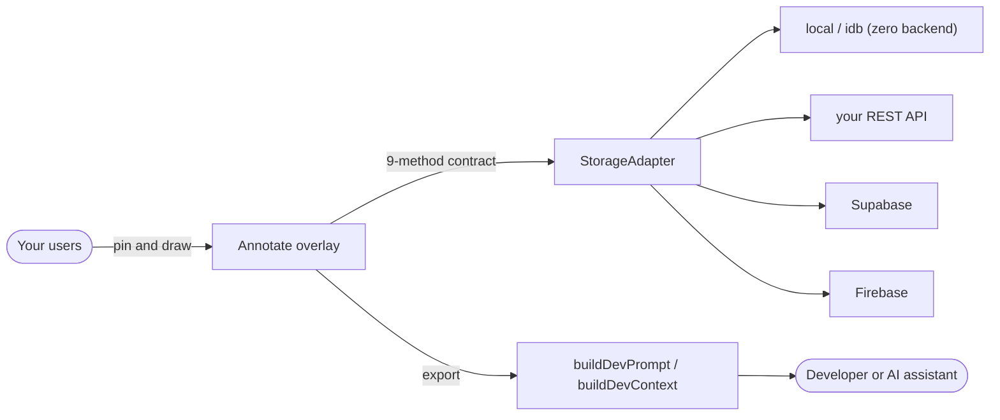

<div align="center">

# 🖍️ annotate-kit

**A drop-in, in-app annotation & visual-feedback overlay for React.**

Pin and draw directly on your live site → capture the element, screenshot, console & network →
export one clean prompt for your developer or any AI assistant.

Backend-agnostic. Safe by default. Free, and works with **zero sign-up**.

[](https://www.npmjs.com/package/annotate-kit)
[](https://github.com/lavish-mitra/annotate-kit/actions/workflows/ci.yml)
[](LICENSE)
[](CONTRIBUTING.md)
[](https://react.dev)

</div>

---

## Why annotate-kit?

Getting precise visual feedback usually means blurry screenshots and vague messages like
_"the button looks off."_ annotate-kit lets anyone mark **exactly** what they mean, right on the live
page, and hands your developer (or any AI coding assistant) a structured, pinpointed change list —
with the element selector, a screenshot, and the console/network context already attached.

- 📌 **Pin & draw** — box, arrow, circle, freehand — with colours, type, priority, status & replies
- 🖼️ **Screenshots** — per-element, full-page, or viewport, with a built-in **markup editor** (draw arrows/boxes/pen); password fields blurred automatically
- 🐛 **Reproducible context** — browser/OS/viewport + opt-in console and network capture
- 🤖 **Tool-agnostic export** — clean markdown *or* structured JSON for any dev or AI assistant
- 🔌 **Any backend** — zero-backend, your REST API, Supabase, Firebase, or write your own (9 methods)
- ⚡ **Realtime** — live updates on Supabase & Firebase (falls back to polling elsewhere)
- 📤 **Deliver anywhere** — optional one-click GitHub issue / webhook / Slack from the Send panel
- 🔒 **Safe by default** — ships admin-only, marks private, capture opt-in, secrets redacted
- 🎨 **Themeable** — light / dark / auto + your brand accent colour, self-contained styles
- ♿ **Accessible** — dialog semantics, labelled controls, full keyboard support

## How it works



---

## 🚀 30-second start (zero backend, no sign-up)

```bash
npm install annotate-kit
# or straight from GitHub:  npm install github:lavish-mitra/annotate-kit
```

```tsx
import { Annotate } from 'annotate-kit'
import { createLocalAdapter } from 'annotate-kit/local'
import 'annotate-kit/styles.css'

export function AnnotateMount() {
  return <Annotate adapter={createLocalAdapter()} />
}
```

Render `<AnnotateMount />` once near your app root. That's it — a floating tool appears, and marks are
saved in the browser. Ready for a demo or local dev without any server.

> Ships prebuilt (`dist/` is committed), so there's no build step on install. Peer deps: `react` and
> `react-dom` (already in your app).

---

## Pick a backend

The overlay talks to storage through **one small adapter** — choose what fits. **None require a
third-party sign-up.**

| Adapter | Import | Best for | Multi-user? |
|---|---|---|---|
| **local** | `annotate-kit/local` | Demos, local dev, single user | ❌ single browser |
| **idb** | `annotate-kit/idb` | Same, but many/large screenshots (IndexedDB) | ❌ single browser |
| **rest** | `annotate-kit/rest` | Your own API on any platform | ✅ your server enforces |
| **supabase** | `annotate-kit/supabase` | Supabase projects | ✅ RLS enforces |
| **firebase** | `annotate-kit/firebase` | Firebase projects | ✅ rules enforce |

**Your own API (any platform):**

```tsx
import { createRestAdapter } from 'annotate-kit/rest'

const adapter = createRestAdapter({
  baseUrl: '/api/annotations',
  headers: () => ({ Authorization: `Bearer ${getToken()}` }), // optional
})
```

See [`src/adapters/rest.ts`](src/adapters/rest.ts) for the exact 9-endpoint contract your API implements.

<details>
<summary><b>Quick start — Supabase</b></summary>

**1. Apply the backend** (once): run [`backend/supabase/migration.sql`](backend/supabase/migration.sql)
via `supabase db push` or the SQL editor. It creates the table, a global toggle, a private
`annotations` bucket, an author-stamping trigger, and RLS policies safe for the anon key.

**2. Mark your admins**: in Supabase Auth, give admin users
`app_metadata.role = "admin"` (or `app_metadata.annotate_admin = true`).

**3. Mount it:**

```tsx
import { Annotate } from 'annotate-kit'
import { createSupabaseAdapter } from 'annotate-kit/supabase'
import { useMemo } from 'react'
import { useLocation, useNavigate } from 'react-router-dom'
import { supabase } from './lib/supabase'
import 'annotate-kit/styles.css'

export function AnnotateMount() {
  const adapter = useMemo(() => createSupabaseAdapter({ client: supabase }), [])
  const { pathname } = useLocation()
  const navigate = useNavigate()
  return <Annotate adapter={adapter} route={pathname} onNavigate={navigate} />
}
```

The tool ships **admin-only** — an admin enables it for everyone from the panel when ready.

</details>

<details>
<summary><b>Quick start — Firebase</b></summary>

**1. Apply the rules + indexes** (once): merge [`backend/firebase/firestore.rules`](backend/firebase/firestore.rules)
and [`backend/firebase/storage.rules`](backend/firebase/storage.rules) into your rules, add the composite
indexes from [`backend/firebase/firestore.indexes.json`](backend/firebase/firestore.indexes.json), and deploy:

```bash
firebase deploy --only firestore:rules,firestore:indexes,storage
```

**2. Mark your admins** via a custom claim (Admin SDK):

```js
await admin.auth().setCustomUserClaims(uid, { admin: true })
```

**3. Mount it:**

```tsx
import { Annotate } from 'annotate-kit'
import { createFirebaseAdapter } from 'annotate-kit/firebase'
import { useMemo } from 'react'
import { db, storage, auth } from './lib/firebase'
import 'annotate-kit/styles.css'

export function AnnotateMount() {
  const adapter = useMemo(() => createFirebaseAdapter({ firestore: db, storage, auth }), [])
  return <Annotate adapter={adapter} route={window.location.pathname} />
}
```

</details>

---

## `<Annotate>` props

| Prop | Type | Default | Notes |
|---|---|---|---|
| `adapter` | `StorageAdapter` | — | **Required.** From `annotate-kit/{local,idb,rest,supabase,firebase}`, or your own. |
| `route` | `string` | `location.pathname` | Pass your router's pathname so marks are page-aware in an SPA. |
| `onNavigate` | `(path) => void` | full-page load | Your router's `navigate`, for smooth cross-page "find on page". |
| `user` | `{ email; name; role }` | from adapter | Override author attribution. |
| `onToast` | `(kind, msg) => void` | built-in toast | Hook into your app's notifications. |
| `pollMs` | `number` | `15000` | Refresh cadence while the tool/panel is open. |
| `theme` | `'light' \| 'dark' \| 'auto'` | `'light'` | Colour theme for the widget's own panels (not the host page). |
| `accent` | `string` | brand indigo | Brand accent colour (any valid CSS colour, e.g. `#0ea5e9`). Invalid values ignored. |
| `captureConsole` | `boolean` | `false` | Attach a rolling console/JS-error buffer to each mark (may contain secrets). |
| `captureNetwork` | `boolean` | `false` | Attach failed/slow fetch+XHR calls; URLs trimmed + redacted. |
| `captureDomSnapshot` | `boolean` | `false` | Attach a sanitised HTML snapshot of the marked element (scripts/handlers stripped, passwords blanked). |
| `captureText` | `boolean` | `true` | Capture on-screen element text. Turn off for sensitive apps. |
| `captureFullUrl` | `boolean` | `false` | Store the full URL (query + hash) instead of just `origin + pathname`. |
| `redactScreenshots` | `boolean` | `true` | Blur password fields and `[data-annot-redact]` elements before capture. |
| `redact` | `(text) => string` | built-in | Redact secrets/PII from captured text + console. Default masks JWTs, tokens, emails, long digit runs. |
| `singleKeyShortcuts` | `boolean` | `true` | Bare-letter tool hotkeys (P/B/A/C/D). Turn off to avoid host-app key collisions. |
| `deliveries` | `Delivery[]` | `[]` | Extra "send to…" buttons in the Send panel — GitHub issue / webhook / Slack / your own. |

> If your adapter supports realtime (Supabase & Firebase do), the overlay updates **live** — you don't
> need to tune `pollMs`.

The tool only renders for users who may use it, and it ships **admin-only** with marks defaulting to
**private** — so it's safe to mount unconditionally: end users see nothing until an admin enables it.

**Keyboard:** `Shift+A` pin · `P/B/A/C/D` tools · `Esc` cancel/close · `⌘/Ctrl+Enter` save ·
`Ctrl+Z` undo · `Shift+H` hide/show · `?` help.

---

## Sending feedback

Open the dock → mark things → **Send**. You get a structured markdown prompt (grouped by page, ordered
by priority, each item naming the exact element, request, environment, and console). Copy it into your
dev chat or any AI assistant. As items get built, flip them to **Done** in the panel.

Two exports are available for your own tooling:

```ts
import { buildDevPrompt, buildDevContext } from 'annotate-kit'

const markdown = buildDevPrompt(items, { includeConsole: true, includeNetwork: true })
const json     = buildDevContext(items) // { total, items: [{ element, note, console, network, … }] }
```

Both are pure functions. The export treats all annotation text as **untrusted data** (a stored
prompt-injection defence) and omits console/network unless you opt in.

### Send straight to your tools (optional)

Add one-click targets to the Send panel. `githubIssueDelivery` needs **no token**; webhook/Slack use a
URL you provide:

```tsx
import { githubIssueDelivery, createWebhookDelivery, createSlackDelivery } from 'annotate-kit'

<Annotate adapter={adapter} deliveries={[
  githubIssueDelivery({ repo: 'you/your-repo' }),                 // opens a prefilled issue (no token)
  createWebhookDelivery({ url: 'https://api.you.dev/feedback' }), // POSTs { prompt, context }
  createSlackDelivery({ webhookUrl: process.env.SLACK_HOOK! }),   // posts to Slack
]} />
```

---

> **Client-side note:** webhook/Slack targets run in the browser — their URL/headers are visible to end
> users, so use non-secret endpoints or proxy secrets through your own server (`githubIssueDelivery`
> needs no token). Also memoize your `adapter` (`useMemo`) so realtime/polling don't re-subscribe each render.

## 🔒 Security & privacy

annotate-kit captures live-app context, so the defaults are conservative — please review before
shipping. See [SECURITY.md](SECURITY.md) for the full policy and how to report issues.

- **Admin-only until enabled**, new marks **private** by default.
- **Screenshots are access-controlled** (Supabase/Firebase): private-mark shots are readable only by
  their owner or an admin; uploads are capped to 5 MB images and can't overwrite existing files.
- **Console & network capture are opt-in** and only hook while the tool is active — no global patching
  at import, and host wrappers (Sentry etc.) are never clobbered.
- **Redaction**: captured text/console is scrubbed (JWTs, tokens, emails, long digit runs); screenshots
  blur password fields and any `data-annot-redact` element. URLs are stored as `origin + pathname`
  unless you opt into `captureFullUrl`.
- **Server-verified identity**: Supabase stamps `created_by`/role from the JWT and pins it immutable;
  Firestore pins `created_by` on update. Authorization is enforced by your backend, not the client.
- **Local / idb adapters** are single-browser only — no multi-user boundary. Use a server-backed
  adapter for shared data.

> ⚠️ The `local` and `idb` adapters store everything in one browser with no access control — great for
> demos and single-user, never for shared/multi-tenant data.

---

## Write your own adapter

Implement 9 methods against any store and the whole UI just works:

```ts
import type { StorageAdapter } from 'annotate-kit'

const myAdapter: StorageAdapter = {
  getAccess,        // who is looking + what they may do
  setAccess,        // flip the global toggle (admin)
  list,             // all visible marks, with screenshot_url resolved
  save,             // persist a new mark → { id }
  update,           // patch status/note/type/priority by id
  remove,           // delete a mark (+ its screenshot)
  addReply,         // append a reply
  clearResolved,    // delete done/dismissed
  uploadScreenshot, // (File, { visibility }) → { path }
}
```

See [`src/adapter.ts`](src/adapter.ts) for the exact contract.

---

## Contributing

Contributions are welcome — bug fixes, adapters, docs, and ideas. Please read
[CONTRIBUTING.md](CONTRIBUTING.md), and note the [Code of Conduct](CODE_OF_CONDUCT.md).

```bash
git clone https://github.com/lavish-mitra/annotate-kit.git
cd annotate-kit && npm install
npm run typecheck && npm test && npm run build
```

## License

[MIT](LICENSE) © annotate-kit contributors — free to use, modify, and distribute.
